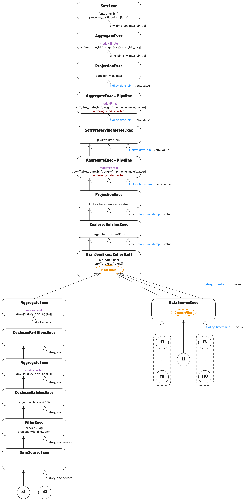
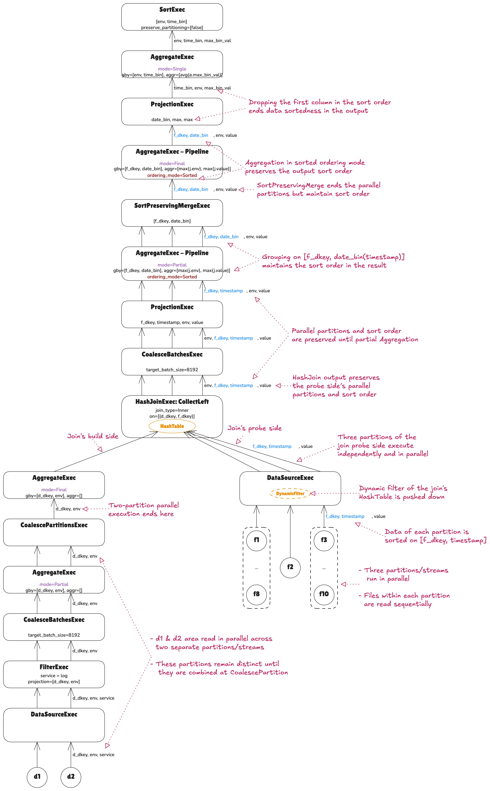
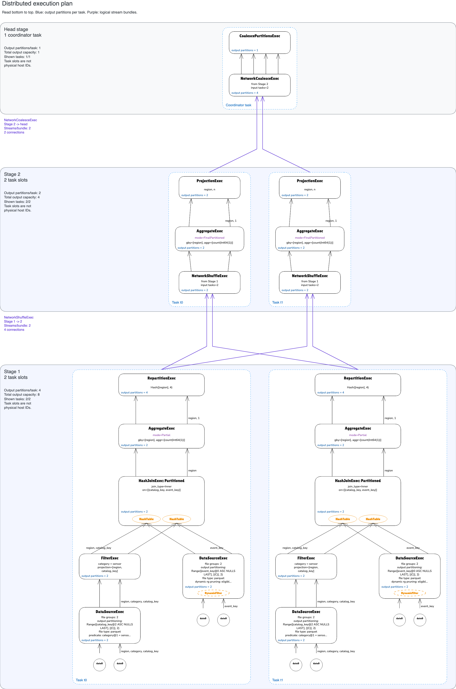
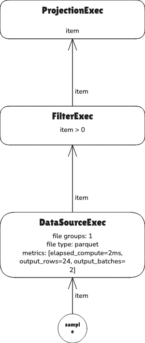
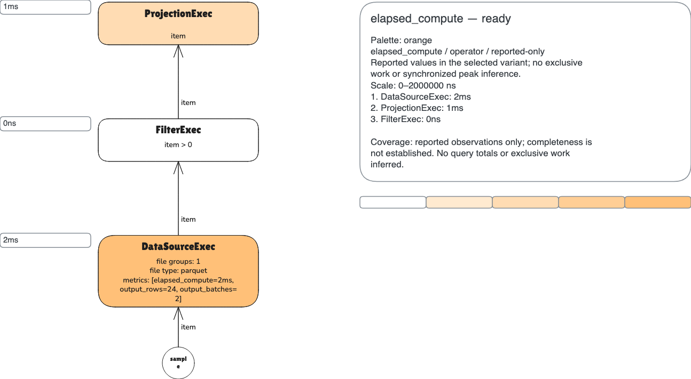
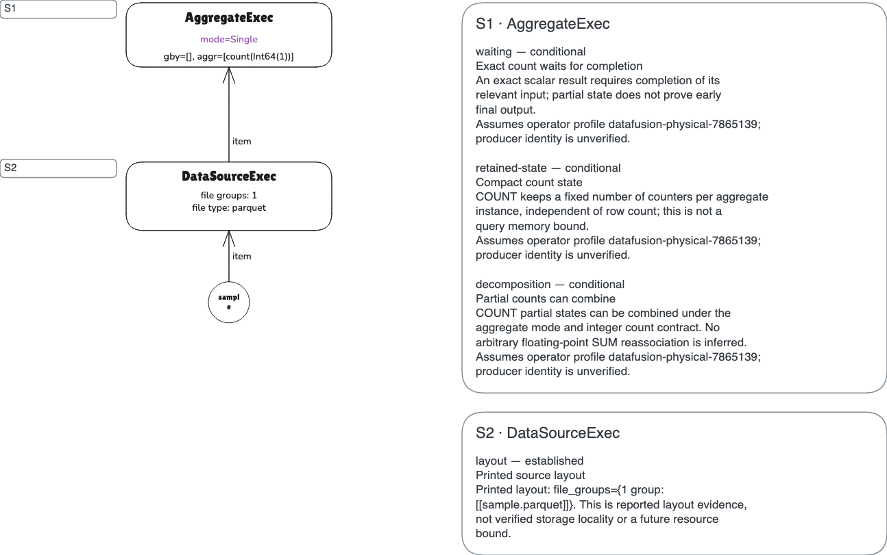

# plan-viz

[](https://www.typescriptlang.org/)
[](https://nodejs.org/)
[](LICENSE)
[](https://google.github.io/styleguide/tsguide.html)
[](https://github.com/NGA-TRAN/plan_viz/actions/workflows/ci-cd.yml)

Convert Apache DataFusion physical EXPLAIN plans into editable **Excalidraw diagrams**.
Visualize operators, parallel streams, ordering and distributed data flow.

Add optional metric labels and heatmaps to explore reported execution measurements.
Enable structural explanations to understand input dependencies, retained state
and data layout. The current plan drawing remains the default; metrics and
structural explanations can be enabled independently.

[Features](#features) · [Metrics](#explore-execution-metrics) · [Structural explanations](#understand-operator-behavior) · [Install](#installation) · [Usage](#usage) · [Documentation](#documentation) · [Issues](https://github.com/NGA-TRAN/plan_viz/issues)

## Features

| Feature | What it provides |
| --- | --- |
| Current plan | Single-node, distributed and custom-operator visualization with the existing default drawing |
| Metric labels | Reported compute time, rows, batches, bytes and supported memory/spill metrics |
| Heatmaps | Orange, Blue or Purple coloring of comparable measurements, with rankings and a legend |
| Structural explanations | Evidence-backed explanations of waiting, retained state, aggregation and data layout |
| Inspection and analysis APIs | Discover available metrics and physical-plan variants; generate structured JSON reports |
| Editable diagrams | Excalidraw scenes with grouped labels, operators, workers and bound connections |

**Unreleased:** metric labels, heatmaps, structural explanations and the new
inspection/analysis APIs are available in the working tree for the next release.
They are not part of published version 0.1.28. Existing default conversion remains
available through the current CLI and synchronous library API.

Missing measurements remain **Not reported**; they never become zero. Orange
heatmaps use white for measured zero. Numeric interpretation of some metrics
requires an explicitly selected producer profile. See the
[plan-view API and CLI guide](docs/PLAN_VIEWS.md) for supported fields and assumptions.

## Single-node plans

Read diagrams from bottom to top. Arrows represent partition streams; blue column
labels mark known sort order. This example combines a join, aggregation, and sorting.

<details open>
<summary>Text plan</summary>

```text
SortExec: expr=[env@0 ASC NULLS LAST, time_bin@1 ASC NULLS LAST], preserve_partitioning=[false]
  AggregateExec: mode=Single, gby=[env@1 as env, time_bin@0 as time_bin], aggr=[avg(a.max_bin_val)]
    ProjectionExec: expr=[date_bin(IntervalMonthDayNano("IntervalMonthDayNano { months: 0, days: 0, nanoseconds: 30000000000 }"),j.timestamp)@1 as time_bin, max(j.env)@2 as env, max(j.value)@3 as max_bin_val]
      AggregateExec: mode=Final, gby=[f_dkey@0 as f_dkey, date_bin(IntervalMonthDayNano("IntervalMonthDayNano { months: 0, days: 0, nanoseconds: 30000000000 }"),j.timestamp)@1 as date_bin(IntervalMonthDayNano("IntervalMonthDayNano { months: 0, days: 0, nanoseconds: 30000000000 }"),j.timestamp)], aggr=[max(j.env), max(j.value)], ordering_mode=Sorted
        SortPreservingMergeExec: [f_dkey@0 ASC NULLS LAST, date_bin(IntervalMonthDayNano("IntervalMonthDayNano { months: 0, days: 0, nanoseconds: 30000000000 }"),j.timestamp)@1 ASC NULLS LAST]
          AggregateExec: mode=Partial, gby=[f_dkey@0 as f_dkey, date_bin(IntervalMonthDayNano { months: 0, days: 0, nanoseconds: 30000000000 }, timestamp@1) as date_bin(IntervalMonthDayNano("IntervalMonthDayNano { months: 0, days: 0, nanoseconds: 30000000000 }"),j.timestamp)], aggr=[max(j.env), max(j.value)], ordering_mode=Sorted
            ProjectionExec: expr=[f_dkey@1 as f_dkey, timestamp@2 as timestamp, env@0 as env, value@3 as value]
              CoalesceBatchesExec: target_batch_size=8192
                HashJoinExec: mode=CollectLeft, join_type=Inner, on=[(d_dkey@0, f_dkey@0)], projection=[env@1, f_dkey@2, timestamp@3, value@4]
                  AggregateExec: mode=Final, gby=[d_dkey@0 as d_dkey, env@1 as env], aggr=[]
                    CoalescePartitionsExec
                      AggregateExec: mode=Partial, gby=[d_dkey@0 as d_dkey, env@1 as env], aggr=[]
                        CoalesceBatchesExec: target_batch_size=8192
                          FilterExec: service@2 = log, projection=[d_dkey@0, env@1]
                            DataSourceExec: file_groups={2 groups: [[d1.parquet], [d2.parquet]]}, projection=[d_dkey, env, service], file_type=parquet, predicate=service@2 = log, pruning_predicate=service_null_count@2 != row_count@3 AND service_min@0 <= log AND log <= service_max@1, required_guarantees=[service in (log)]
                  DataSourceExec: file_groups={3 groups: [[f1.parquet, f4.parquet, f5.parquet, f6.parquet, f7.parquet, f8.parquet], [f2.parquet], [f3.parquet, f9.parquet, f10.parquet]]}, projection=[f_dkey, timestamp, value], output_ordering=[f_dkey@0 ASC NULLS LAST, timestamp@1 ASC NULLS LAST], file_type=parquet, predicate=DynamicFilter [ empty ]
```

</details>



[Plan text](docs/assets/join-aggregates.txt) · [SQL and EXPLAIN](tests/join_aggregates.sql) · [Editable Excalidraw](tests/expected/join_aggregates.excalidraw) · [Annotated diagram](docs/assets/join_aggregates_with_analyses.png)

<details>
<summary>How to read the plan</summary>

The pink annotations explain the arrows, file groups, hash tables, and sort-order
highlights. Follow the streams from the sources at the bottom toward the result
at the top to see where operators preserve or reduce parallelism.



</details>

## Distributed physical plans

Stages appear as rows, with consumers above producers. Blue badges show output
partitions per task. Purple arrows bundle streams between tasks and connect to the
receiving network operator. Ellipses mark omitted tasks or connections; task slots
do not represent physical machines.

Equivalent tasks show their first and last instances by default; this example has
two tasks per stage, so both are shown. Use `--all-workers` to draw every task in
larger plans. See [distributed conventions and limits](docs/DISTRIBUTED_PLANS.md).

### Range-partitioned join with dynamic filtering

Two tasks join range-partitioned catalog and event inputs, with dynamic filters
on the event scans. They partially aggregate counts by region, then hash-shuffle
the results to two final aggregation tasks. The coordinator gathers their four
output streams and coalesces them into one.

<details open>
<summary>Text plan</summary>

```text
┌───── DistributedExec
│ CoalescePartitionsExec
│   [Stage 2] => NetworkCoalesceExec: output_partitions=4, input_tasks=2
└──────────────────────────────────────────────────
  ┌───── Stage 2 ── tasks=2, partitions=2
  │ ProjectionExec: expr=[region@0 as region, count(Int64(1))@1 as n]
  │   AggregateExec: mode=FinalPartitioned, gby=[region@0 as region], aggr=[count(Int64(1))]
  │     [Stage 1] => NetworkShuffleExec: output_partitions=2, input_tasks=2
  └──────────────────────────────────────────────────
    ┌───── Stage 1 ── tasks=2, partitions=4
    │ RepartitionExec: partitioning=Hash([region@0], 4), input_partitions=2
    │   AggregateExec: mode=Partial, gby=[region@0 as region], aggr=[count(Int64(1))]
    │     HashJoinExec: mode=Partitioned, join_type=Inner, on=[(catalog_key@1, event_key@0)], projection=[region@0]
    │       FilterExec: category@1 = sensor, projection=[region@0, catalog_key@2]
    │         DistributedLeafExec:
    │           t0: DataSourceExec: file_groups={2 groups: [[fixtures/catalog/catalog_key=A/data0.parquet], [fixtures/catalog/catalog_key=C/data0.parquet]]}, projection=[region, category, catalog_key], output_partitioning=Range([catalog_key@2 ASC NULLS LAST], [(C)], 2), file_type=parquet, predicate=category@1 = sensor, pruning_predicate=category_null_count@2 != row_count@3 AND category_min@0 <= sensor AND sensor <= category_max@1, required_guarantees=[category in (sensor)]
    │           t1: DataSourceExec: file_groups={2 groups: [[fixtures/catalog/catalog_key=B/data0.parquet], [fixtures/catalog/catalog_key=D/data0.parquet]]}, projection=[region, category, catalog_key], output_partitioning=Range([catalog_key@2 ASC NULLS LAST], [(C)], 2), file_type=parquet, predicate=category@1 = sensor, pruning_predicate=category_null_count@2 != row_count@3 AND category_min@0 <= sensor AND sensor <= category_max@1, required_guarantees=[category in (sensor)]
    │       DistributedLeafExec:
    │         t0: DataSourceExec: file_groups={2 groups: [[fixtures/events/event_key=A/data0.parquet], [fixtures/events/event_key=C/data0.parquet]]}, projection=[event_key], output_partitioning=Range([event_key@0 ASC NULLS LAST], [(C)], 2), file_type=parquet, predicate=DynamicFilter [ event_key@2 >= A AND event_key@2 <= A AND event_key@2 IN (SET) ([<values>]) ], dynamic_rg_pruning=eligible, pruning_predicate=event_key_null_count@1 != row_count@2 AND event_key_max@0 >= A AND event_key_null_count@1 != row_count@2 AND event_key_min@3 <= A AND event_key_null_count@1 != row_count@2 AND event_key_min@3 <= A AND A <= event_key_max@0, required_guarantees=[event_key in (A)]
    │         t1: DataSourceExec: file_groups={2 groups: [[fixtures/events/event_key=B/data0.parquet], [fixtures/events/event_key=D/data0.parquet]]}, projection=[event_key], output_partitioning=Range([event_key@0 ASC NULLS LAST], [(C)], 2), file_type=parquet, predicate=DynamicFilter [ event_key@2 >= B AND event_key@2 <= B AND event_key@2 IN (SET) ([<values>]) ], dynamic_rg_pruning=eligible, pruning_predicate=event_key_null_count@1 != row_count@2 AND event_key_max@0 >= B AND event_key_null_count@1 != row_count@2 AND event_key_min@3 <= B AND event_key_null_count@1 != row_count@2 AND event_key_min@3 <= B AND B <= event_key_max@0, required_guarantees=[event_key in (B)]
    └──────────────────────────────────────────────────
```

</details>



[Plan text](tests/distributed/dynamic_filter_range_join.sql) · [Full-size diagram](docs/assets/distributed-dynamic-filter-range-join.png) · [Editable Excalidraw](tests/distributed/expected/dynamic_filter_range_join.excalidraw)

## Explore execution metrics

Choose **Current plan**, **Labels only** or **Labels + heatmap**. Select the metric
you want to inspect and, for heatmaps, choose **Orange / Blue / Purple**. Orange
is the default palette. Larger comparable values receive stronger color; the
report includes rankings and a legend for the selected comparison group.

This synthetic example reports 2 ms at the source, 1 ms at the projection and
0 ns at the filter. The zero-valued filter is white. These are reported operator
measurements, not a sum or an inferred query duration.

<details>
<summary>Current plan — the same input with optional views off</summary>



[Editable current plan](tests/plan-views/timers/expected/default.excalidraw)

</details>

**Labels + heatmap — elapsed compute, Orange**



[Sample input](tests/plan-views/timers/input.sql) · [Full-size diagram](docs/assets/plan-view-heatmap-orange.png) · [Editable heatmap](tests/plan-views/timers/expected/orange.excalidraw)

For fuller examples to load in an app, use the [single-node and distributed metric
samples](samples/README.md). They include synthetic execution measurements, empty
input, zero versus missing values, and instructions for selecting producer profiles.

Plans without metrics still render successfully. When a requested metric is
missing, its status is **Not reported** and no numeric heatmap is fabricated.
Non-numeric or conflicting values remain raw. Counts, bytes and distributed task
maps require applicable producer assumptions; query metrics stay in separate
query details. See [metric interpretation and ownership](docs/PLAN_VIEWS.md#values-ownership-and-missing-metrics).

## Understand operator behavior

Enable structural explanations to see where operators may wait for input, retain
state, combine partial results or expose a particular data layout. Findings show
their evidence and distinguish conditional claims from unknown behavior.

In this synthetic scalar COUNT example, the selected operator profile explains
that COUNT retains compact counter state, while its exact final result still
requires input completion. Compact aggregate state does not establish a bound on
the whole query's memory.



[Sample input](tests/plan-views/count/input.sql) · [Full-size diagram](docs/assets/plan-view-count-structure.png) · [Editable explained plan](tests/plan-views/count/expected/structure.excalidraw)

Structural explanations work independently of metric display and can also be
combined with a heatmap. Execution claims require an applicable, explicitly
selected operator profile; without it, those claims remain unknown. This delivery
supports physical plans. See [supported structural explanations](docs/PLAN_VIEWS.md#structural-explanations).

## Custom and unfamiliar operators

Operators with unfamiliar names can reuse source, aggregate, repartition, or join
renderers when their properties and child counts match. Their original names remain
visible; unmatched operators get neutral boxes with their inputs connected.

```text
FilterExec: value@1 > 100
  MeadowScanExec: file_groups={2 groups: [[a.parquet], [b.parquet]]}, projection=[id, value], file_type=parquet
```

Here `MeadowScanExec` uses the file-source renderer automatically. No registration
or extra installation is needed. Inline wrappers are also supported. For a custom
appearance, register a `NodeGeneratorStrategy` through the library's
`customGenerators` option; see the [custom-operator guide](docs/CUSTOM_OPERATORS.md).

## Prerequisites

Node.js **20+** and npm. Distributed support requires **plan-viz 0.1.25+**.

## Installation

One package supports single-node plans, distributed plans, and custom operators:

```sh
npm install plan-viz
```

For building from source or contributing, see [development setup](CONTRIBUTING.md#setup).

## Usage

### CLI

Save your physical EXPLAIN output as `plan.txt`, then run:

```sh
npx plan-viz -i plan.txt -o output.excalidraw
```

The plan format is detected automatically. For snapshot files with multiple sections,
add `--section 2` (1-based). See [all CLI options](docs/CLI.md).

### Optional views — unreleased

The following commands use the new CLI options. To try them in a local checkout,
run `npm run build` and use `node dist/cli.js` in place of `npx plan-viz`.

```sh
# Compute-time heatmap
npx plan-viz -i plan.txt \
  --metric-display heatmap --metric elapsed_compute --palette orange \
  -o heatmap.excalidraw

# Structural explanations under an explicitly selected operator profile
npx plan-viz -i plan.txt \
  --structure explain --operator-profile datafusion-physical-7865139 \
  -o explained.excalidraw
```

Use `--metric-display labels` for labels without heatmap coloring. Omit optional
view flags to keep the current drawing. The operator profile above is a caller
assumption about the producer, not automatic engine detection.

### Library

```javascript
const { readFileSync, writeFileSync } = require('node:fs');
const { convertPlanToExcalidraw } = require('plan-viz');

const plan = readFileSync('plan.txt', 'utf8');
const scene = convertPlanToExcalidraw(plan);
writeFileSync('output.excalidraw', JSON.stringify(scene, null, 2));
```

The same function accepts single-node and distributed plans. Use
`ConverterService.convertDetailed()` for diagnostics; see the [API reference](docs/API.md).

For optional views, use the new async API. This ES-module example creates a
heatmap scene and its analysis report:

```javascript
import { convertPlanView } from 'plan-viz';

const planText = `ProjectionExec: expr=[item@0 as item], metrics=[elapsed_compute=0ns]
  EmptyExec, metrics=[elapsed_compute=2ms]`;

const result = await convertPlanView(planText, {
  metrics: { display: 'heatmap', metric: 'elapsed_compute', palette: 'orange' },
});
// result.scene: editable Excalidraw data to load or save.
// result.metrics: status, comparable values, rankings and legend.
```

Use `getPlanViewCapabilities()` and `inspectPlan()` to discover display choices,
profiles, metrics and physical variants. Use `analyzePlan()` when only the report
is needed. All new input-consuming APIs return Promises and require WebCrypto;
browser integrations need a secure context. See the [full plan-view guide](docs/PLAN_VIEWS.md).

### View and edit

Open `output.excalidraw` in [Excalidraw](https://excalidraw.com/) or an IDE Excalidraw
extension. Edit the diagram, annotate it, or export PNG/SVG for sharing.

You can also paste plan text into the [plan-visualizer web app](https://nga-tran.github.io/plan-visualizer).
Its supported features depend on the library version deployed there.

The new features are delivered through the CLI/API. Interactive metric, display
and palette dropdowns are implemented by the viewer app. The
[plan_visualizer integration guide](docs/PLAN_VISUALIZER_INTEGRATION.md) provides
the upgrade steps and app acceptance checks. Both it and the plan-view API guide
are included in the package prepared for the next release.

## Documentation

| Guide | Contents |
|---|---|
| [Quick start](QUICKSTART.md) | Install or build, convert, and open a drawing |
| [API](docs/API.md) / [CLI](docs/CLI.md) | Configuration, input formats, diagnostics, and options |
| [Optional plan views](docs/PLAN_VIEWS.md) / [App integration](docs/PLAN_VISUALIZER_INTEGRATION.md) | Metrics, structural explanations and plan_visualizer upgrade checks; included in the package |
| [Distributed plans](docs/DISTRIBUTED_PLANS.md) | Task/stream conventions, routing, and limitations |
| [Custom operators](docs/CUSTOM_OPERATORS.md) | Automatic inference, wrappers, and custom renderers |
| [Operator catalog](docs/operators/README.md) | Supported operators and execution contracts |
| [Corpus review](docs/CORPUS_REVIEW.md) | Inventory and render collections of saved plans |
| [Upstream maintenance](docs/UPSTREAM_MAINTENANCE.md) / [Review log](docs/UPSTREAM_REVIEW_LOG.md) | Track DataFusion changes and validated compatibility |
| [Architecture](docs/ARCHITECTURE.md) / [Project structure](docs/PROJECT_STRUCTURE.md) | Internals and source layout |

More examples: [single-node fixtures](tests/) and [distributed fixtures](tests/distributed/),
with editable drawings in [tests/expected](tests/expected/) and
[tests/distributed/expected](tests/distributed/expected/).

## Contributing

See [CONTRIBUTING.md](CONTRIBUTING.md) for setup, tests, visual review, commits, and releases.

[MIT license](LICENSE) · [Changelog](CHANGELOG.md) · [GitHub](https://github.com/NGA-TRAN/plan_viz)
