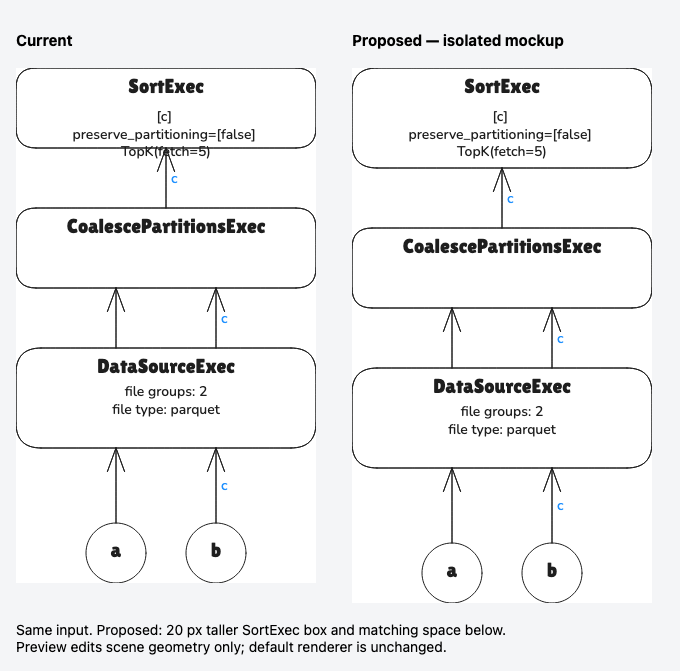

# Follow-up execution: F4 and F5

This continues the [first upstream review](2026-11-08.md). The user authorized
starting F4/F5 on 2026-11-08, before returning to Pierre/Wenqi design.

## Order and scope

Run **F4, then F5**. Corpus classification determines which inputs are complete
plans, so it should be reliable before using the corpus as compatibility evidence.
Keep this work on `maintenance/upstream-validation-20261108`, separate from
[documentation PR #78](https://github.com/NGA-TRAN/plan_viz/pull/78).

1. **F4 — corpus classification:** distinguish annotated planner sketches,
   header-only assertions, and complete plans followed by routing logs. Keep
   original input/provenance and genuine complete-plan errors. Add failing tests
   first, fix only review tooling, then compare historical/current corpus results.
2. **F5 — focused compatibility validation:** turn source-derived fetch,
   sorted-source, task-assignment and scan examples into durable regressions.
   Exercise conversion, scene export and editor bindings; inspect representative
   drawings. Attempt relevant native upstream tests and record their actual
   scope/results. Keep broader certification or unavailable checks explicitly open.
3. Record results here and in the review log. Only advance the audited source pin
   when the changed execution contracts have sufficient evidence. A passing
   operator-name inventory or corpus conversion alone is insufficient.

Preserve default visualization. Any proposed rendering change needs concrete
current/proposed previews and the user's approval before integration, as required
by [AGENTS.md](../../AGENTS.md#visualization-stability-and-user-approval).

## Status

- F4: implemented; focused tests and old/new corpus comparisons passed.
- F5: focused regression/native/browser/visual validation complete; the approved
  TopK correction (F5-V1 below) is implemented. No audited-pin upgrade.
- F1–F3: retained for subsequent shared/Pierre/Wenqi design; not started here.
- F6: deferred; no `pgjson` or planner-debug input adapter requested.
- Support pin: remains Distributed `b32ee66e5f12227a5fe8e8444a022991da0758ea`.
- PR #78: merged when rechecked at the end of this work; all CI checks passed.
  The agent did not perform that merge. The user subsequently authorized committing,
  pushing and opening a separate F4/F5 implementation PR before coverage follow-up.

## Validation results

Original triage manifests remain preserved in ignored
`tmp/upstream_review_20261108/`. New results are under its `follow-up/` directory.

### F4

- Added and ran failing tests before the classifier/extractor implementation.
  All 11 new tests pass, including CLI checks that malformed plans still fail
  and original mixed output is saved alongside the extracted plan.
- Verified the suite from a clean checkout state without `dist/`, matching CI's
  test-before-build order. Pure classification loads independently; the CLI test
  builds the production entry point before exercising it.
- Historical corpus: 294 rendered, 27 partial, 652 excluded, 4 unsupported,
  25 unavailable; no conversion failures. All 321 scene hashes match the
  original triage run.
- Current corpus: 327 rendered, 2 partial, 747 excluded, 35 unsupported,
  26 unavailable; no conversion failures. All 328 comparable scene hashes match
  the original run. The extracted Iceberg plan adds one rendered scene.
- All 30 annotated planner sketches now have the same explicit unsupported
  classification: 14 previously failed and 16 previously produced misleading
  rendered/partial entries. One header-only assertion is now excluded. These
  changes explain the totals; no parser errors were suppressed.
- F4 leaves the CLI/library parser and renderer unchanged. Unknown/malformed trailers
  remain visible failures; extraction recognizes only the observed routing format.

### F5

- Added nine saved examples with exact source provenance and adaptation notes in
  [the fixture README](../../tests/upstream/2026-11-08/README.md), checked by
  [the regression suite](../../tests/upstream-review.test.ts). All nine pass.
- Pinned operator audit passes: 20 operators; no missing/stale entries or missing
  test paths. This verifies the existing pin, not certification of current main.
- Native execution at Distributed `64a0a13...`: all eight `sorted_data_source`
  and four `task_finished_handler` tests passed. These include static/adaptive
  ordered shuffles, empty scans, success/failure/incomplete task states and
  handler metric delivery. The upstream lockfile uses **DataFusion 55.0.0**;
  this run does not execute the DataFusion 55.2.0 optimizer probes.
- Native Iceberg assigned-file routing: both tests passed, exercising the actual
  per-task files and stable placement across union branches/queries at the same
  Distributed revision and lockfile.
- Current-corpus plus fixture PNG export: 338/338 passed with all labels drawn;
  geometry/binding checks reported no errors. Six contact sheets were generated.
  Export success does not establish text containment (see the TopK finding).
- Inspected all nine focused fixture PNGs, plus a distributed version of the
  TopK example. Sorted routing, retained local sorts, empty input slots and
  planned-file/partition labels are readable in these examples. This is
  representative inspection, not manual approval of all 329 upstream scenes.
- The two partial upstream scenes remain explicit: the metrics documentation
  example lacks routing/count evidence, and the broadcast planner example is
  a recording without task identity/upstream stages.
- Actual Excalidraw editor checks passed: worker, operator and network-input
  dragging, bindings, CLI conversion and invalid-section handling; no page errors.
- Contribution gates passed: clean/build, lint, 70 suites / 887 tests, coverage
  thresholds (97.94% statements, 91.19% branches), package dry run, whitespace
  and local documentation-link checks.

## F5-V1 — existing single-node TopK label overflow

**Status: visually approved, implemented and validated; publication authorized.**

The user approved the displayed correction and explicitly requested no commit
before local review: “Approve the visualization changes. Continue but do not
commit yet. I also want to review them local first.” The subsequent instruction
to commit, push and open a PR supersedes that temporary hold.

The `replacement-topk.sql` example prints three detail lines in `SortExec`.
The existing generator reserves only 35 pixels for those lines inside an
80-pixel node. The rendered text needs 52.5 pixels, so the last line crosses the
node border and incoming arrow. Existing geometry checks trust the stored text
height; the PNG export verifies that the label is drawn, not that it fits.

The approved correction is narrowly scoped: grow affected single-node sort boxes
to fit their detail text, retaining the existing labels/styles and spacing between
nodes. The mockup below uses a 100-pixel box and shifts the subtree down 20 pixels.
It edits a copy of the generated scene only, so it demonstrates appearance but
does not prove a general renderer fix. The
[distributed version](assets/topk-distributed-current-2026-11-08.png) already fits
this text through its layout normalization; preserve that behavior.



Implementation and validation:

- Added failing containment tests for `fetch=5` and `fetch=0`, plus bound/unbound
  audit-label overflow tests. All now pass. The audit also avoids comparing a
  panel with itself when it has multiple bound labels.
- Sort details retain their position and use their full multiline height. A box
  grows only when the details need more space. Distributed partition-badge
  layout continues to manage its own sizing; its TopK scene is protected by an
  exact saved-scene regression and remains byte-for-byte identical.
- Actual minimal TopK output is byte-for-byte identical to the approved isolated
  mockup. Fetched coalesce and ordered-merge control examples are unchanged.
- Inspected the four affected existing fixtures: `limit_sort_sortPreservingMerge`,
  `tpch_q3`, `tpch_q9`, and `tpch_q11`. Updated their expected geometry while
  preserving fixture identifiers and groups. The other 82 existing fixture scenes
  remain unchanged; all 88 integration tests (including pairing checks) pass.
- Compared all 338 current-corpus/fixture scenes against the F4/F5 results:
  333 unchanged, four upstream single-node TopK examples and the minimal TopK
  fixture changed. No new geometry errors; distributed scenes are unchanged.
- All 16 before/after PNGs exported with all labels drawn. The local review page
  loads all eight comparisons and all 16 editable scene downloads without errors.
- Clean/build, lint, 70 suites / 892 tests, coverage thresholds, package dry run,
  and actual Excalidraw CLI/worker/operator/network-input editing checks pass.
  Existing upstream-native test results still apply; execution semantics did not
  change and those engine tests were not rerun for this sizing correction.

Editable current/proposed scene copies and the distributed check are saved locally
under `tmp/upstream_review_20261108/follow-up/topk-preview/` as the approval record.
Actual before/after converter output, logs and comparison evidence are under
`tmp/upstream_review_20261108/follow-up/topk-implementation/`.

### Local review artifacts

Open the local review page at `http://127.0.0.1:8765/` while its server is running.
It includes the minimal fix, distributed and fetch controls, the four affected
existing fixtures, zoom controls, PNGs and editable Excalidraw downloads.
The right-hand panels show actual implementation output, not mockups.

To restart it from the repository root:

```sh
python3 -m http.server 8765 --bind 127.0.0.1 --directory tmp/upstream_review_20261108/follow-up/topk-implementation
```

The HTML also works when opened directly from that directory. These local
artifacts remain available after publication; private research is not included
in the implementation PR.

## F5-V2 — expected drawings for all upstream inputs

The user requested complete scene comparisons in addition to semantic checks.
The existing integration suite covered related operators but did not discover
these nine inputs; only the constructed distributed TopK example had a saved
scene comparison.

- Added automatic discovery of upstream review directories to the existing
  integration runner, reusing its scene normalization and text-binding checks.
  All nine `.sql` inputs now have matching `expected/<name>.excalidraw` files.
  Pairing checks fail for missing or orphaned drawings in each review directory.
- Moved the additional constructed distributed TopK baseline unchanged into
  `expected/derived/`; its existing exact-scene test remains in the semantic suite.
  It has no separate `.sql` input because the test adds the coordinator wrapper.
- Confirmed the new tests fail for all nine missing drawings before adding them.
  Generated the drawings, exported all nine PNGs, and verified every scene is
  byte-for-byte identical to the previously reviewed implementation output.
  All nine have successful label exports and no geometry errors.
- Kept the semantic assertions for counts, routing, task-local files, ordering
  and text containment. No renderer change was made for this coverage addition.
- Local review: `http://127.0.0.1:8765/snapshots/`, with all nine editable scenes,
  PNGs and a thumbnail overview. The original review page links to this gallery.

Validation passed: clean/build, lint, 70 suites / 902 tests, coverage thresholds,
package dry run, whitespace and documentation-link checks. The local gallery
loads all nine PNGs, editable scenes and source links without browser errors.
The user authorized publishing this completed batch before the coverage follow-up.

## Next coverage work

Keep the following test improvements on a separate branch from this implementation
PR. Preserve existing rendering and add matching expected scenes for representative
new valid-plan fixtures.

1. Distributed task assignments: malformed task maps, duplicate child assignments
   and unknown capacity, including empty assigned tasks.
2. Interleave ordering: assert outgoing order for mismatched/unsorted inputs,
   multiple-column label groups and single-partition inputs.
3. Arrow bindings: coincident endpoints and parallel geometry; verify finite,
   bounded attachment values and minimum gaps.

Run focused tests followed by the contribution gates; record before/after coverage.
Any discovered bug that needs a visible rendering change still requires concrete
previews and approval before integration.

## Reproduce the validation

After the clean build, run from the repository root (paths below are local
checkouts at the recorded revisions):

```sh
npx jest --runInBand --coverage=false tests/review-corpus.test.ts tests/upstream-review.test.ts
node scripts/review-corpus.cjs --upstream tmp/support_distributed_plans/upstream --output tmp/upstream_review_20261108/follow-up/corpus-baseline
node scripts/review-corpus.cjs --upstream tmp/upstream_review_20261108/datafusion-distributed --fixtures tests/upstream/2026-11-08 --output tmp/upstream_review_20261108/follow-up/corpus-current --render
node scripts/corpus-contact-sheets.cjs tmp/upstream_review_20261108/follow-up/corpus-current
node scripts/verify-distributed.cjs tmp/upstream_review_20261108/follow-up/browser-check
node scripts/audit-upstream-operators.cjs tmp/support_distributed_plans/upstream
```

From the current Distributed checkout, using its unchanged lockfile:

```sh
cargo +1.95.0 test --locked --features integration --test sorted_data_source --test task_finished_handler -- --test-threads=1
cargo +1.95.0 test --locked -p datafusion-distributed-iceberg --test assigned_file_routing -- --test-threads=1
```

The executed commands reused the baseline checkout's `target/` cache through
`--target-dir`. Logs, the scene-hash comparison, galleries and editor screenshots
are preserved in the local `follow-up/` directory. The source checkout stays clean.

F1–F3 and F6 retain their previous disposition. Full current-main certification,
native DataFusion 55.2.0 optimizer execution and an audited-pin upgrade remain
outside these focused checks. Keep support claims qualified by this evidence.
